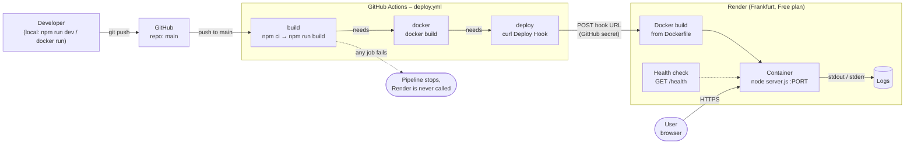
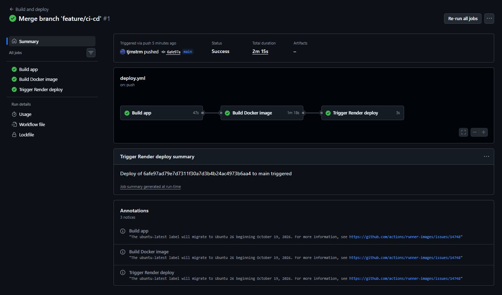
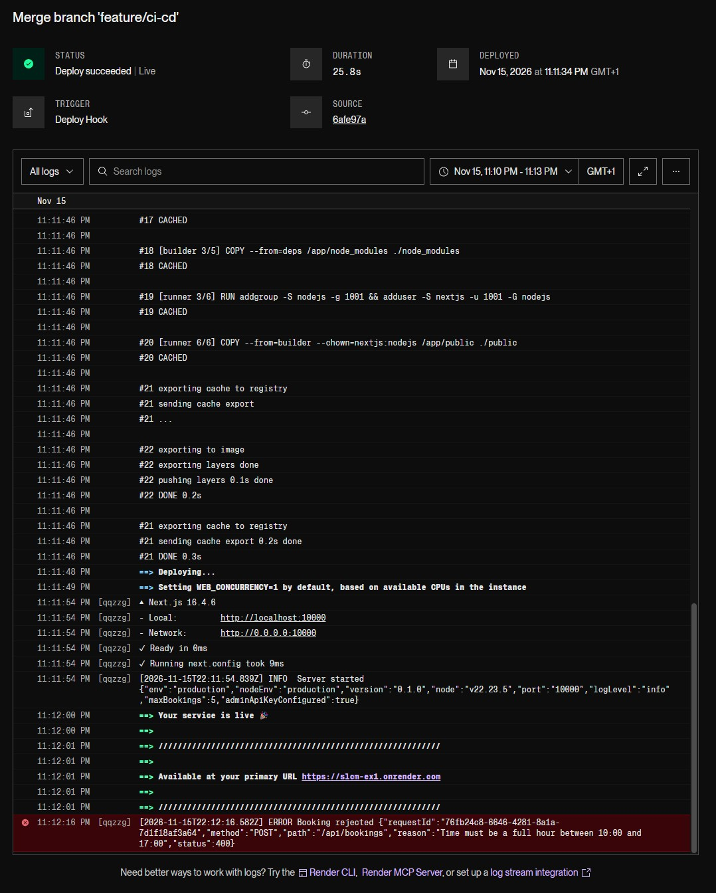
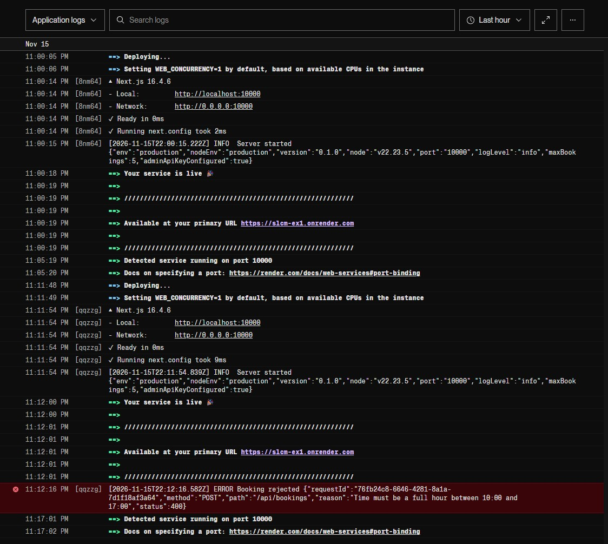

# SLCM Examination 1 – Booking calendar

A small booking app built with **Next.js**, packaged with **Docker**, checked by a **GitHub Actions** pipeline and deployed to **Render**.

**Live app:** https://slcm-ex1.onrender.com
**Health check:** https://slcm-ex1.onrender.com/health

> The app runs on Render's free plan. If nobody has visited it for 15 minutes the first request can take about a minute while the instance wakes up.

---

## Contents

1. [The application](#1-the-application)
2. [Choice of framework](#2-choice-of-framework)
3. [Architecture](#3-architecture)
4. [Running locally](#4-running-locally)
5. [Docker](#5-docker)
6. [Environment variables and secrets](#6-environment-variables-and-secrets)
7. [Logging and health check](#7-logging-and-health-check)
8. [CI/CD with GitHub Actions](#8-cicd-with-github-actions)
9. [Deployment on Render](#9-deployment-on-render)
10. [Cost-aware operation](#10-cost-aware-operation)
11. [Security](#11-security)
12. [Screenshots](#12-screenshots)

---

## 1. The application

A weekly calendar where you book one-hour time slots between 10:00 and 18:00, every day of the week.

| Page / endpoint | What it does |
|---|---|
| `/` – Dashboard | Number of upcoming bookings and the next booked slot |
| `/bookings` – Calendar | Week view (Mon–Sun). Enter your name and click a free slot to book it, or cancel a booking. Past slots are disabled. **This is the interactive feature.** |
| `/settings` | Shows the non-secret runtime configuration (environment, log level, booking limit). Makes the dev/prod difference visible. |
| `/profile` | Placeholder page |
| `GET /health` | Health check used by Render and Docker |
| `GET/POST /api/bookings` | List / create bookings |
| `DELETE /api/bookings/:id` | Cancel a booking |
| `DELETE /api/bookings` | Admin only: remove all bookings. Requires the `ADMIN_API_KEY` secret in the `x-admin-key` header. |

Rules that are enforced **on the server** (not only in the UI):

- only full hours between 10:00 and 17:00 (the last slot is 17–18), in Stockholm time
- no bookings in the past, no impossible dates (e.g. `2026-02-31`), no double bookings
- at most `MAX_BOOKINGS` upcoming bookings (default 5)

Bookings are stored **in memory** in the server process. This is a deliberate simplification for the assignment; see [limitations](#10-cost-aware-operation).

---

## 2. Choice of framework

**Next.js 16 (App Router) with TypeScript and Tailwind CSS.**

- **One process for both UI and server.** The pages, the API (`app/api/...`) and the `/health` endpoint are all served by the same Next.js server. Unlike React + Vite, no separate Express server is needed for logging and health checks.
- **Server-side code can read secrets.** Route handlers and server components run on the server, so `process.env.ADMIN_API_KEY` is never sent to the browser.
- **`output: "standalone"`** produces a self-contained `server.js` with only the dependencies it actually needs. This gives a small Docker image (≈ 86 MB of content).
- **`instrumentation.ts`** is Next.js's official hook that runs once when the server starts. It is used for the startup log and for logging unhandled errors.

---

## 3. Architecture



### Technical decisions

| Decision | Why |
|---|---|
| **Render builds the image itself** from the Dockerfile (no Docker Hub) | Fewer moving parts, no registry credentials, and the exact same Dockerfile is verified in CI first. |
| **Auto-Deploy: Off + Deploy Hook** | Render only deploys when the pipeline says so. A commit that does not build never reaches production. |
| **CI builds the Docker image but does not push it** | Proves the Dockerfile works before Render spends time on it. Render's build then rarely fails. |
| **Multi-stage Dockerfile** (`deps → builder → runner`) | The final image contains no source code, no dev dependencies and no build tools. It is smaller, faster to deploy and has less attack surface. |
| **Runtime config, not build-time config** | All settings are read from `process.env` **per request** on the server (`await connection()`). The same image can therefore run as development or production. `NEXT_PUBLIC_*` variables are deliberately not used, because they are baked into the browser bundle at build time and are public. |
| **One config module** (`lib/config.ts`) | All environment variables are read and validated in one place. Invalid values are logged as errors and replaced with safe defaults. |
| **Own small logger** (`lib/logger.ts`) | Log levels, timestamps, JSON context and a request-id, without an extra dependency. |
| **Region Frankfurt** | Inside the EU (GDPR) and close to the users. |

### Project structure

```
app/
  page.tsx, bookings/, settings/, profile/   pages
  api/bookings/route.ts                      list / create / admin reset
  api/bookings/[id]/route.ts                 cancel a booking
  health/route.ts                            GET /health
components/   navigation.tsx, booking-calendar.tsx
lib/
  config.ts     validated runtime configuration
  logger.ts     leveled logger with request-id
  bookings.ts   in-memory store + validation
  slots.ts      opening hours and time helpers (Stockholm time)
instrumentation.ts, instrumentation-node.ts   startup log + error hook
Dockerfile, .dockerignore, .env.example
.github/workflows/deploy.yml
```

---

## 4. Running locally

Requires Node.js 22 (≥ 20.9).

```bash
npm ci                         # install exact versions from package-lock.json
cp .env.example .env.local     # create local config (never committed)
npm run dev                    # http://localhost:3000
```

To run the production build locally:

```bash
npm run build
npm start
```

---

## 5. Docker

```bash
docker build -t slcm-ex1 .
docker run --rm -p 3000:3000 --env-file .env.local slcm-ex1
```

Open http://localhost:3000. Run `docker ps`: after about 30 seconds the container shows as **healthy**, thanks to the `HEALTHCHECK` that calls `/health`.

Run it the way Render does (Render sets `PORT=10000`):

```bash
docker run --rm -p 3000:10000 -e PORT=10000 -e APP_ENV=production -e LOG_LEVEL=info slcm-ex1
```

### The Dockerfile

| Stage | Base | Does |
|---|---|---|
| `deps` | `node:22-alpine` | `npm ci`. Cached until `package*.json` changes, so code changes rebuild fast. |
| `builder` | `node:22-alpine` | Copies the source and runs `npm run build` (standalone output). |
| `runner` | `node:22-alpine` | Copies only `.next/standalone`, `.next/static` and `public`. Runs as the non-root user `nextjs`, with `NODE_ENV=production` and `HOSTNAME=0.0.0.0` (reachable from outside the container). `PORT` defaults to 3000 and can be overridden. Starts with `node server.js`. |

`.dockerignore` keeps `node_modules`, `.next`, `.git` and **all `.env*` files** out of the build context, so no secret can end up in an image layer.

---

## 6. Environment variables and secrets

### Variables

| Variable | Secret? | Development (local) | Production (Render) | Effect |
|---|---|---|---|---|
| `APP_ENV` | no | `development` | `production` | Badge in the sidebar (orange/green), defaults for the log level |
| `LOG_LEVEL` | no | `debug` | `info` | Which log lines are printed (`debug` < `info` < `warn` < `error`) |
| `MAX_BOOKINGS` | no | `5` | `5` | Maximum number of upcoming bookings |
| `ADMIN_API_KEY` | **yes** | local key | separate production key | Protects `DELETE /api/bookings` |
| `PORT` | no | 3000 (default) | set by Render | Port the server listens on |
| `RENDER_DEPLOY_HOOK_URL` | **yes** | – | GitHub Actions secret | Lets the pipeline start a deploy |

All values are listed with placeholders in [`.env.example`](.env.example).

### Development vs production

| | Development | Production |
|---|---|---|
| Where | Your own computer (`npm run dev` or `docker run`) | Render web service `slcm-ex1` |
| Started by | You | GitHub Actions → Deploy Hook |
| Config from | `.env.local` (gitignored) | Render → Environment |
| Logging | `debug`: also health checks and list requests | `info`: only meaningful events and errors |
| Admin key | Local test key | Separate key, only stored in Render |

The `/settings` page and the coloured badge show which environment you are looking at. The startup log line prints the active configuration, without secret values.

### How secrets are handled

- **Never in git.** `.gitignore` excludes `.env*` except `.env.example`, which only contains placeholders.
- **Never in the Docker image.** `.dockerignore` excludes `.env*`, and configuration is injected at runtime.
- **Production secrets live in Render.** They are stored encrypted and are only visible to members of the Render workspace.
- **The Deploy Hook URL is a GitHub Actions secret** (`RENDER_DEPLOY_HOOK_URL`). Anyone holding that URL can trigger a deploy, so it is not written in the workflow file. It is passed to `curl` via `env:` and GitHub masks it in the logs.
- **Server-only.** `ADMIN_API_KEY` is only read in server code. The browser never receives it, `/settings` shows only "configured (hidden)", and the logs only record *whether* it is set.
- **Variables exposed to the browser are not secret.** In Next.js, anything prefixed with `NEXT_PUBLIC_` is compiled into the JavaScript that every visitor downloads. That is why this project does not use such variables for anything sensitive.
- **Different keys per environment.** Leaking the local key does not give access to production.

---

## 7. Logging and health check

### Log format

Every line has a timestamp, a level, a message and JSON context:

```
[2026-11-15T22:11:54.839Z] INFO  Server started {"env":"production","version":"0.1.0","port":"10000","logLevel":"info","maxBookings":5,"adminApiKeyConfigured":true}
[2026-11-15T22:12:16.582Z] ERROR Booking rejected {"requestId":"76fb24c8-…","method":"POST","path":"/api/bookings","reason":"Time must be a full hour between 10:00 and 17:00","status":400}
```

| Level | Used for | Examples |
|---|---|---|
| `INFO` (`console.info`) | Normal events | Server started, booking created or cancelled, admin reset |
| `WARN` (`console.warn`) | Odd but not broken | Admin endpoint called while no key is configured |
| `ERROR` (`console.error`) | Something went wrong | Invalid JSON, rejected booking, unknown booking id, wrong admin key, invalid configuration value, unhandled server errors (`onRequestError`) |
| `DEBUG` (`console.debug`) | Details while troubleshooting, hidden in production | Health checks, booking list requests |

- **Startup log:** `instrumentation.ts` runs once in the server process when it starts, and logs the environment, version, port and configuration.
- **Request-id:** every API request gets an id. It is added to every log line for that request and returned to the client in the `x-request-id` response header. A user's error can then be matched to the exact log lines.
- **No sensitive data in logs:** passwords, keys and the admin key that was sent are never logged.
- **Where to read them:** everything is written to stdout/stderr. That is what `docker logs` and **Render → Logs** show. Errors appear in red in Render.

### Health check

`GET /health` returns:

```json
{ "status": "ok", "env": "production", "version": "0.1.0", "uptimeSeconds": 18,
  "timestamp": "2026-11-15T22:25:51.297Z", "bookings": 0, "memoryMb": 91 }
```

- It is configured as **Health Check Path** in Render and as `HEALTHCHECK` in the Dockerfile.
- `Cache-Control: no-store` and `await connection()` make sure it reflects the live process. Without them it would be a snapshot from build time.
- It is logged at `debug` level, so frequent polling does not flood the production logs.

### Using them when troubleshooting

> Monitoring detects the problem, logs explain it.

1. **Is the app up at all?** Open `/health`. No answer means the container is not running: check Render → Events for a failed deploy, and Render → Logs for a crash during startup (the `Server started` line is missing).
2. **Is the right version deployed?** `version` and `env` in `/health` show what is running and where.
3. **Does it keep restarting?** If `uptimeSeconds` keeps going back to 0, the container is crashing or the free instance is spinning down.
4. **Is it running out of memory?** `memoryMb` compared with the plan's 512 MB.
5. **A user reports an error.** Take the `x-request-id` from the response and search for it in Render's logs. All lines for that request appear, including the `reason`.
6. **Did the deploy break something?** Compare the time of the first `ERROR` lines with the `Deploying…` line. If they coincide, roll back to the previous deploy in Render and fix the problem.

---

## 8. CI/CD with GitHub Actions

File: [`.github/workflows/deploy.yml`](.github/workflows/deploy.yml)

```
push to main ──► build ──needs──► docker ──needs──► deploy ──► Render
                   │                 │                 │
                   ✗ fails           ✗ fails           ✗ secret missing / HTTP error
                   └── pipeline stops, deploy is skipped, Render keeps the old version
```

| Job | Steps |
|---|---|
| **build** | Check out code → set up Node.js 22 (with npm cache) → `npm ci` → `npm run build` |
| **docker** (`needs: build`) | Check out code → `docker build -t slcm-ex1:<commit-sha> .`. The image is **not** pushed anywhere. |
| **deploy** (`needs: [build, docker]`) | Calls the Render Deploy Hook with `curl` and writes a summary line |

Details:

- **Trigger:** `push` to `main`, plus `workflow_dispatch` for manual runs.
- **Secret handling:** the hook URL comes from `secrets.RENDER_DEPLOY_HOOK_URL` and is passed through `env:`. If the secret is missing, the job fails with a clear `::error::` message instead of a confusing `curl` error.
- **`curl -fsS`:** if Render answers with an HTTP error, the step fails, so the run doesn't show green when nothing was deployed.
- **`permissions: contents: read`:** the workflow gets the minimum rights it needs.
- **`concurrency` with `cancel-in-progress`:** if you push twice quickly, the older run is cancelled, so an outdated commit can never be deployed after a newer one.
- **No tests and no Docker Hub,** as required by the assignment.

### What happens if the build fails?

The failing job turns red and every job that `needs` it is **skipped**, so the deploy hook is never called. Render is not contacted and **keeps serving the last working version**, and users notice nothing. GitHub marks the commit with a red ✗ and notifies the author. Fix the error, push again, and the pipeline runs from the start.

If something fails later, in Render's own Docker build, the deploy is marked as failed in Render → Events and the previous deploy stays live.

---

## 9. Deployment on Render

**Service:** `slcm-ex1`, a web service with runtime **Docker**, branch `main`, region **Frankfurt**, plan **Free**.

| Setting | Value | Why |
|---|---|---|
| Language | Docker | Render builds the image from our `Dockerfile` |
| Auto-Deploy | **Off** | Only GitHub Actions starts deploys, via the Deploy Hook |
| Health Check Path | `/health` | Render checks that the new version answers before treating the deploy as live |
| Environment | `APP_ENV`, `LOG_LEVEL`, `MAX_BOOKINGS`, `ADMIN_API_KEY` | See [section 6](#6-environment-variables-and-secrets) |
| Port | set by Render (`PORT=10000`) | `server.js` listens on `$PORT` at `0.0.0.0` |

**The flow of a deploy**

1. A developer pushes to `main` (or merges a feature branch).
2. GitHub Actions builds the app, then the Docker image.
3. If both succeed, the deploy job calls the secret Deploy Hook URL.
4. Render pulls the commit, builds the image from the Dockerfile and starts the container.
5. Render calls `/health`. When it answers, the deploy is marked **Live** and traffic goes to the new container.
6. The new container logs `INFO Server started …`, which is visible in Render → Logs.

**Verified:** changing the dashboard heading to "SLCM Examination 1" and pushing to `main` triggered the pipeline (build 21 s, Docker 57 s, hook 2 s). The change was live on the public URL about a minute later.

---

## 10. Cost-aware operation

**Which Render plan is used?**
The **Free** instance type: 0.1 CPU and 512 MB RAM, $0/month.

**Why?**
It is a demo app with very little traffic and no database or disk. Measured through `/health`, the app uses about 55–100 MB of memory, well within 512 MB. The free plan's main drawback, sleeping after 15 minutes without traffic, is acceptable for a school project.

**Which factors affect the cost?**

- **Instance type (CPU/RAM).** The next steps up are $7/month (0.5 CPU, 512 MB) and $25/month (1 CPU, 2 GB). Paid instances are billed for the time they run, whether or not anyone uses them.
- **Number of instances and services.** A separate staging/dev service or extra instances for scaling multiply the cost.
- **Traffic and bandwidth.** More users mean more CPU per second and more outgoing data.
- **Extra resources:** a database, persistent disks, a custom domain and paid monitoring or log tools.
- **Build and pipeline time.** Every push runs GitHub Actions and a Render build. Public repositories get Actions minutes for free, private ones have a quota.

**How can resource usage be reduced?**

- **Small image:** a multi-stage build and standalone output (≈ 86 MB content) give faster builds and deploys and less storage.
- **Docker layer caching:** dependencies are only reinstalled when `package*.json` changes. Render's log shows most layers as `CACHED`.
- **Prerendering:** Next.js prerenders the static parts of each page (partial prerendering), so less work is done per request.
- **Log volume:** `LOG_LEVEL=info` in production and health checks at `debug` keep the logs small.
- **CI minutes:** `concurrency` cancels outdated pipeline runs, and the npm cache speeds up `npm ci`.
- **The free plan's spin-down** means the instance doesn't use resources when nobody visits.

**What are the limitations of the current setup?**

- **Cold starts:** after 15 minutes without traffic the instance sleeps, and the next visit takes about a minute.
- **Data is lost on every restart or deploy,** because bookings live in memory. They are also not shared between instances, so the app cannot be scaled horizontally as it is.
- **0.1 CPU:** enough for a demo, but slow under load.
- **Free plan restrictions:** no zero-downtime deploys (a deploy can cause a short interruption), no scaling, no persistent disk, no SSH.
- **One region and one instance:** no redundancy if the instance or the region has problems, for example during Render's maintenance windows.
- **No user accounts:** anyone can cancel any booking. That's acceptable for the assignment, but not for a real product.
- **No alerting:** problems are found by looking at `/health` and the logs, and nothing notifies anyone automatically.

**What would need to change with significantly more users?**

1. **A database,** for example Render Postgres. Bookings then survive restarts and are shared, which is a requirement for running more than one instance. The database also needs its own monitoring and backups, since it often becomes the bottleneck.
2. **A paid instance:** no spin-down, zero-downtime deploys, more CPU and RAM (vertical scaling).
3. **Several instances behind Render's load balancer** (horizontal scaling). This is only possible once the state lives in the database.
4. **Authentication and rate limiting,** so users can only cancel their own bookings and the API can't be flooded.
5. **Caching / CDN** for static files, and caching of read-heavy data.
6. **Monitoring and alerts:** forward the logs to a log service, add metrics such as error rate and response time, and alert on symptoms (for example error rate above X % for 5 minutes). The request-id is already in place for tracing.
7. **A staging environment:** a second Render service on a `dev` branch with its own variables, so changes can be tested in the cloud before they reach production. Later possibly blue-green or canary deploys.
8. **Automated tests in the pipeline** (unit tests with Vitest, end-to-end tests with Playwright) before the Docker build.

---

## 11. Security

| Measure | Where |
|---|---|
| No secrets in git, image or browser bundle | `.gitignore`, `.dockerignore`, server-only config |
| Separate secrets per environment | local `.env.local` vs Render environment |
| Container runs as a non-root user | `Dockerfile` (`USER nextjs`) |
| Least-privilege CI token | `permissions: contents: read` |
| Deploy only through the pipeline | Auto-Deploy Off + secret Deploy Hook |
| All input validated on the server | `lib/bookings.ts`. The UI checks are only a convenience. |
| Admin action protected by a secret key, failed attempts logged | `DELETE /api/bookings` |
| No secrets or personal data in logs | `lib/logger.ts` usage |

**Known gaps:** no user authentication, no rate limiting, and the admin key is a single shared key, not per user. A real product would need all three, see point 4 in the scaling list above.

---

## 12. Screenshots

**GitHub Actions:** the build, Docker build and Render trigger all succeeded.


**Render:** a successful deploy, triggered by the Deploy Hook.


**Render Logs:** an `INFO` startup message and an `ERROR` from a rejected booking.

